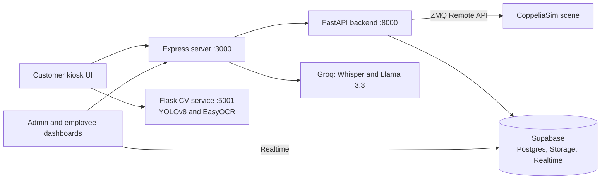

# NaviBot

NaviBot is an autonomous supermarket assistant robot, simulated in CoppeliaSim. Shoppers use a touchscreen kiosk on the robot to find products by voice or text, build a small shopping cart, and get guided to each shelf along an optimized route. When it is not serving a customer, NaviBot patrols the aisles, compares shelf images against reference photos to flag out of stock and low stock items, and reads price tags to catch price mismatches. Store staff monitor the robot, its logs and its alerts in real time from admin and employee dashboards.

- Demo video: https://youtu.be/hrcZsQken_4
- Website: https://www.navibot.live

University capstone project (CSIT321), University of Wollongong in Dubai, 2025/26.

## Features

- **Voice and text product search.** Speech is transcribed with Groq Whisper and the product names are extracted with Llama 3.3.
- **Product locator.** Shows where a product is and guides the shopper to the shelf.
- **Smart cart.** Up to 5 items, visited in an optimized order: A* path planning on an occupancy grid with greedy nearest neighbour ordering.
- **Shopping list scanning.** The camera captures a shopping list and EasyOCR reads it into a cart.
- **Product scanner.** A YOLOv8 model trained on 6 items identifies a product held up to the camera.
- **Patrol mode.** Compares live shelf images with reference images (ORB features, homography alignment and image differencing) to flag out of stock and low stock, and OCRs price tags to flag price mismatches.
- **Admin and employee dashboards.** Live logs and alerts through Supabase Realtime.
- **Manual overrides.** Stop, patrol, power off, return to base and deploy to an aisle.
- **Login lockout** after 3 failed attempts.

## Architecture



- **navibot-server/** Node.js and Express. Serves the kiosk UI (`public_ui/`) and the login and dashboards (`public_auth/`), proxies API calls to the backend and calls Groq for voice search.
- **Backend/** Python and FastAPI. Product search, navigation, patrol and override endpoints. `Navibot_controller_new.py` drives the robot in CoppeliaSim through the ZMQ Remote API and runs path planning and shelf analysis. `db.py` and `auth.py` talk to Supabase Postgres and Storage.
- **OpenCV/** Python and Flask. Camera feed, YOLOv8 product detection (`best.pt`) and EasyOCR.
- **NaviBot_Scene.ttt** The CoppeliaSim store scene with the robot.

## Tech stack

- Simulation: CoppeliaSim (ZMQ Remote API)
- Backend: Python, FastAPI, Uvicorn, psycopg, passlib (bcrypt)
- Computer vision: OpenCV, Ultralytics YOLOv8, EasyOCR, Flask
- Frontend server: Node.js, Express, Multer
- Data: Supabase (Postgres, Storage, Realtime)
- Speech and language: Groq (Whisper, Llama 3.3)

## Setup and run

Requirements: Windows (the commands below use PowerShell), Python 3, Node.js, CoppeliaSim Edu, and a Supabase project with the NaviBot tables. Keep the folder structure as it is.

### 1. CoppeliaSim

1. Download CoppeliaSim Edu from https://www.coppeliarobotics.com/ and install it.
2. Open the scene `NaviBot_Scene.ttt`. Do not start the simulation yet.

Do not click "Abort Execution" in CoppeliaSim. If you do, restart the backend server.

### 2. Environment files

Copy each example file and fill in the values (see the table below):

```powershell
Copy-Item Backend\.env.example Backend\.env
Copy-Item navibot-server\.env.example navibot-server\.env
```

### 3. Backend (terminal 1)

```powershell
Set-ExecutionPolicy -Scope Process Bypass
cd Backend
python -m venv .venv
.\.venv\Scripts\Activate.ps1
pip install -r requirements.txt
python seed_db.py        # optional: load the store layout, planogram and products into the database
python create_user.py    # creates the dashboard account from ADMIN_USERNAME / ADMIN_PASSWORD
uvicorn app:app --port 8000
```

### 4. Frontend server (terminal 2)

```powershell
cd navibot-server
npm install
node server.js
```

Open http://localhost:3000 for the customer kiosk, or http://localhost:3000/login for the dashboards. All links are printed in the terminal.

### 5. CV service (terminal 3)

```powershell
cd OpenCV
python -m venv .venv
.\.venv\Scripts\Activate.ps1
pip install -r requirements.txt
python app_camera.py
```

### 6. Start the simulation

In CoppeliaSim, with the scene loaded, click "Start/resume simulation". After sending a command from the kiosk or a dashboard, make sure the simulation is running.

The product scanner recognises these items only: Water, Pepsi, Cola, Cheerios, Froot Loops, Lucky Charms.

A VS Code task, "Launch Full Stack" (`.vscode/tasks.json`), starts the three servers once the virtual environments exist.

## Environment variables

| Variable | File | Purpose |
| --- | --- | --- |
| `DATABASE_URL` | Backend/.env | Postgres connection string for the Supabase database |
| `SUPABASE_URL` | Backend/.env | Supabase project URL |
| `SUPABASE_ANON_KEY` | Backend/.env | Public key served to the dashboards for Realtime |
| `SUPABASE_SERVICE_ROLE_KEY` | Backend/.env | Server side key for Storage and alerts |
| `PRODUCT_BUCKET` | Backend/.env | Storage bucket for images (default `images`) |
| `ALERT_TABLE` | Backend/.env | Table for patrol alerts (default `alerts`) |
| `REFERENCE_PREFIX` | Backend/.env | Bucket folder with reference shelf images (default `refrences`) |
| `ADMIN_USERNAME` | Backend/.env | Dashboard account name for `create_user.py` (default `admin`; the name `John Doe` opens the employee dashboard) |
| `ADMIN_PASSWORD` | Backend/.env | Password for that account (required by `create_user.py`) |
| `GROQ_API_KEY` | navibot-server/.env | Groq key for voice search |

The OpenCV service needs no environment variables.

## Team

- Omar Morsy: Project Leader, Developer
- Aveesha Dahanayake: Scribe, Developer
- Caiden Caeiro: Developer
- Ali Shamohammadi: Developer
- Siraj Um Munir: Developer
- Bin Huang: Developer

University capstone project, UOW Dubai, 2025/26.
